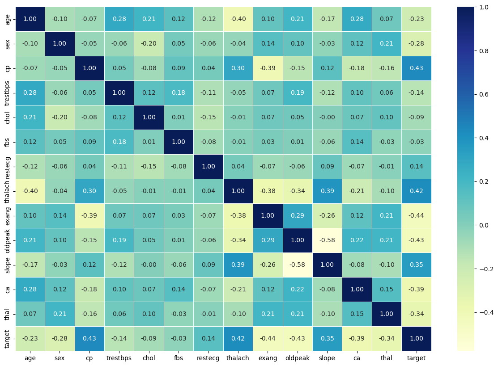
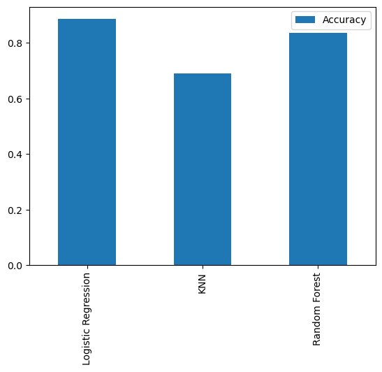
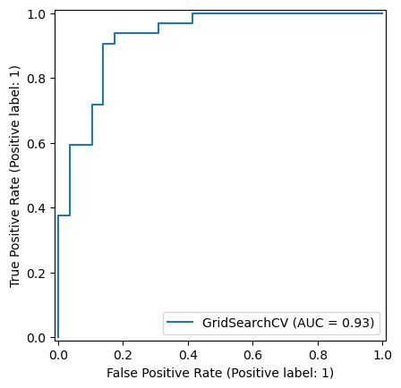
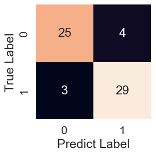
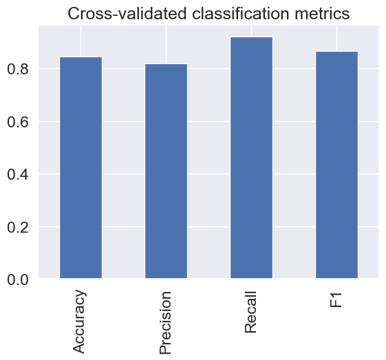
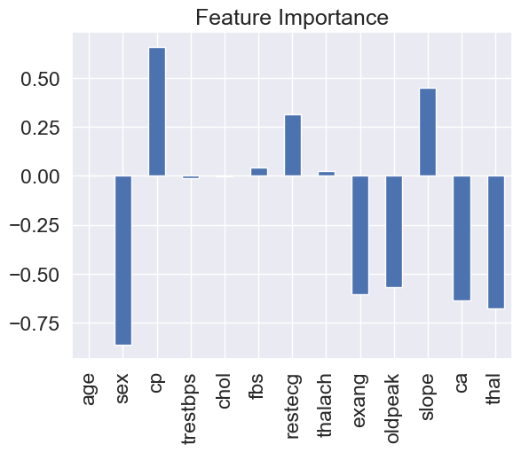

# Heart Disease Detector: Machine Learning Classification


[](LICENSE)

An end-to-end binary classification project that predicts whether a patient has heart disease from 13 clinical measurements. It compares three scikit-learn classifiers, tunes them with randomized and grid search, and evaluates the best one with accuracy, precision, recall, F1, ROC/AUC, a confusion matrix, and 5-fold cross-validation.

> **Disclaimer:** this is a learning and proof-of-concept project built on a small public dataset. It is not a medical device and must not be used to diagnose or make health decisions.

## Table of Contents

- [Overview](#overview)
- [Dataset](#dataset)
- [Approach](#approach)
- [Results](#results)
- [Tech Stack](#tech-stack)
- [Installation](#installation)
- [Usage](#usage)
- [Configuration](#configuration)
- [Project Structure](#project-structure)
- [Known Issues & Limitations](#known-issues--limitations)
- [Roadmap](#roadmap)
- [Contributing](#contributing)
- [License](#license)
- [Author & Support](#author--support)
- [Acknowledgments](#acknowledgments)

## Overview

> Given clinical parameters about a patient, can we predict whether or not they have heart disease?

The project follows a standard workflow: problem definition, data, evaluation target, features, modelling, and experimentation. The success criterion set at the start was **95% accuracy** during the proof of concept. The final model did not reach it (see [Results](#results)).

## Dataset

The data comes from the Cleveland heart disease data in the [UCI Machine Learning Repository](https://archive.ics.uci.edu/dataset/45/heart+disease). This project uses a [Kaggle copy](https://www.kaggle.com/datasets/johnsmith88/heart-disease-dataset), loaded as `heart-disease.csv`.

| | |
|---|---|
| Patients (rows) | 303 |
| Columns | 14 (13 features + `target`) |
| Target | `1` = heart disease (165 patients, 54%), `0` = no heart disease (138 patients, 46%) |
| Missing values | None |
| Sex | 207 male, 96 female |
| Age | 29 to 77 (mean 54.4) |

| Feature | Meaning |
|---|---|
| `age` | Age in years |
| `sex` | 1 = male, 0 = female |
| `cp` | Chest pain type (0 to 3) |
| `trestbps` | Resting blood pressure (mm Hg) |
| `chol` | Serum cholesterol (mg/dl) |
| `fbs` | Fasting blood sugar above 120 mg/dl (1 = true) |
| `restecg` | Resting electrocardiogram result (0 to 2) |
| `thalach` | Maximum heart rate achieved |
| `exang` | Exercise-induced angina (1 = yes) |
| `oldpeak` | ST depression induced by exercise relative to rest |
| `slope` | Slope of the peak exercise ST segment (0 to 2) |
| `ca` | Number of major vessels colored by fluoroscopy (0 to 3) |
| `thal` | Thalassemia test result |

The notebook includes a fuller data dictionary. The data file is not included in this repository, so download it and place it next to the notebook.



## Approach

1. **Exploratory analysis:** class balance, disease frequency by sex and chest pain type, age vs. maximum heart rate, and a correlation matrix.
2. **Split:** 80% train (242 patients) and 20% test (61 patients), shuffled with `np.random.seed(42)`.
3. **Baselines:** Logistic Regression, K-Nearest Neighbors, and Random Forest with default settings.
4. **Tuning:**
   - KNN: sweep `n_neighbors` from 1 to 20
   - Logistic Regression and Random Forest: `RandomizedSearchCV` (20 candidates, 5-fold CV)
   - Logistic Regression again with `GridSearchCV` (30 values of `C`, 5-fold CV)
5. **Evaluation beyond accuracy:** ROC curve and AUC, confusion matrix, classification report, and cross-validated accuracy, precision, recall, and F1.
6. **Interpretation:** the Logistic Regression coefficients, checked against crosstabs of the raw data.

## Results

**Test accuracy (61 held-out patients):**

| Model | Default | After tuning |
|---|---|---|
| Logistic Regression | 88.5% | 88.5% (`C` about 0.204, `liblinear`) |
| Random Forest | 83.6% | 86.9% (`n_estimators=210`, `max_depth=3`, `min_samples_leaf=19`) |
| K-Nearest Neighbors | 68.9% | 75.4% (best at `k=11`) |



Logistic Regression was the best model, and tuning did not improve it. It was used as the final model.

**Final model (Logistic Regression, tuned):**

| Metric | Test set (61 patients) | 5-fold cross-validation (all 303) |
|---|---|---|
| Accuracy | 88.5% (54 of 61) | 84.5% |
| Precision | 0.88 | 0.82 |
| Recall | 0.91 | 0.92 |
| F1 | 0.89 | 0.87 |
| AUC | 0.93 | |

Test confusion matrix (rows are true labels, columns are predictions): 25 true negatives, 4 false positives, 3 false negatives, and 29 true positives.

<p>
  
  
</p>



**Reading the numbers honestly:**

- The 95% accuracy target was **not met**: the test score is 88.5% and the cross-validated accuracy is 84.5%.
- The test set has only 61 patients, so one patient changes accuracy by about 1.6 points. Cross-validation (fold accuracy ranged from 75% to 90%) is the steadier estimate.
- Recall is the strongest metric (about 0.92 in cross-validation), which matters if the goal is to avoid missing patients with the disease. The cost is more false alarms.

**Logistic Regression coefficients** (features were not scaled, so sizes are not directly comparable):



Positive coefficients push the prediction toward `target = 1`: `cp`, `slope`, and `restecg`. The strongest negative ones are `sex`, `thal`, `ca`, `exang`, and `oldpeak`.

## Tech Stack

- **Language:** Python 3
- **Data and plots:** pandas, NumPy, Matplotlib, seaborn
- **Modeling:** scikit-learn (`LogisticRegression`, `KNeighborsClassifier`, `RandomForestClassifier`, `RandomizedSearchCV`, `GridSearchCV`, `cross_val_score`, `RocCurveDisplay`)
- **Environment:** Jupyter Notebook

## Installation

```bash
# 1. Clone the repository
git clone https://github.com/vjabarca/ML-Classification-Heart-Disease-Detector.git
cd ML-Classification-Heart-Disease-Detector

# 2. Create and activate a virtual environment
python -m venv .venv
source .venv/bin/activate        # Windows: .venv\Scripts\activate

# 3. Install dependencies
pip install numpy pandas matplotlib seaborn scikit-learn jupyter

# 4. Put heart-disease.csv (from Kaggle or UCI) next to the notebook, then launch it
jupyter notebook end-to-end-heart-disease-classification.ipynb
```

## Usage

1. Place `heart-disease.csv` in the same folder as the notebook.
2. Run the notebook top to bottom. Everything runs in seconds on a laptop.
3. Key steps in code:

   ```python
   X = df.drop("target", axis=1)
   y = df["target"]

   np.random.seed(42)
   X_train, X_test, y_train, y_test = train_test_split(X, y, test_size=0.2)

   clf = LogisticRegression(C=0.20433597178569418, solver="liblinear")
   clf.fit(X_train, y_train)

   clf.score(X_test, y_test)                  # accuracy
   clf.predict_proba(X_test.iloc[[0]])        # probability for one patient
   ```

4. The evaluation cells then produce the ROC curve, confusion matrix, classification report, and cross-validated metrics.

## Configuration

| Setting | Where | Default |
|---|---|---|
| Data file | `pd.read_csv("heart-disease.csv")` | repo root |
| Test size | `train_test_split(..., test_size=0.2)` | 20% |
| Random seed | `np.random.seed(42)` | 42 |
| Search budget | `n_iter`, `cv` | 20, 5 |
| Logistic Regression | `C`, `solver` | 0.204, `liblinear` |

No API keys are needed.

## Project Structure

```text
.
├── end-to-end-heart-disease-classification.ipynb   # EDA, modelling, evaluation
├── heart-disease.csv                               # not included (download it)
├── docs/
│   ├── correlation_heatmap.png
│   ├── model_comparison.png
│   ├── roc_curve.png
│   ├── confusion_matrix.png
│   ├── cv_metrics.png
│   └── coefficients.png
├── LICENSE
└── README.md
```

## Known Issues & Limitations

- **Very small dataset:** 303 patients (61 in the test set), so scores have wide uncertainty and the results may not generalize.
- **Target not reached:** the proof-of-concept goal was 95% accuracy, and the best result was 88.5% on the test set (84.5% cross-validated).
- **Test set used for selection:** model comparison and the KNN `k` choice looked at test-set scores, which makes those numbers somewhat optimistic. A separate validation set or nested cross-validation would be cleaner.
- **Check the label coding before interpreting the model:** some patterns in the data run opposite to clinical expectation if `target = 1` means disease. For example, typical angina (`cp = 0`) is mostly `target = 0` (104 of 143), exercise-induced angina (`exang = 1`) is mostly `target = 0` (76 of 99), and men have a lower share of `target = 1` than women (45% vs. 75%). The target or feature coding in this copy of the data may not match its documentation. Verify against the UCI documentation before drawing medical conclusions. The model itself simply learns the labels as given.
- **Unscaled features:** Logistic Regression coefficients are not comparable across features with different scales (for example `chol` vs. `sex`), so the coefficient chart is only a rough guide. The default Logistic Regression also failed to converge within 100 iterations in the baseline run.
- **Unstratified split:** `train_test_split` is not stratified and has no `random_state` argument (it relies on the global NumPy seed).
- **Tuning gains are small:** tuned Logistic Regression scores the same as the default one, so the extra search mostly confirms the baseline.
- **No external validation:** all data comes from one source, with no check on other hospitals or populations.

## Roadmap

- [ ] Verify and document the target and feature coding against the UCI source
- [ ] Scale features (for example with a `Pipeline` and `StandardScaler`) and re-run the comparison
- [ ] Use a validation set or nested cross-validation so the test set is only used once
- [ ] Use a stratified, seeded split
- [ ] Try gradient boosting (XGBoost, CatBoost, LightGBM) and compare
- [ ] Add calibration curves and choose a decision threshold that favors recall
- [ ] Export the final model (for example with `joblib`) and add a small prediction script or app
- [ ] Add a `requirements.txt` with pinned versions

## Contributing

Contributions, bug reports, and feature ideas are welcome.

1. **Report a bug or request a feature:** open an [issue](https://github.com/vjabarca/ML-Classification-Heart-Disease-Detector/issues) and include what you expected, what happened, and your environment (Python and scikit-learn versions).
2. **Submit a change:**
   1. Fork the repository
   2. Create a branch: `git checkout -b feature/your-feature`
   3. Commit your changes with a clear message
   4. Push the branch and open a pull request describing what changed and why

Please clear notebook outputs (they may contain local file paths) before committing.

## License

Distributed under the MIT License. See [`LICENSE`](LICENSE) for details. The dataset is **not** covered by this license and has its own terms.

## Author & Support

**Victor J. Abarca**, San José, CA

- GitHub: [@vjabarca](https://github.com/vjabarca)

For questions or problems, please open an issue in this repository.

## Acknowledgments

- The [UCI Machine Learning Repository](https://archive.ics.uci.edu/) and the original Cleveland Clinic data contributors for the heart disease dataset
- The Kaggle copy of the dataset by [johnsmith88](https://www.kaggle.com/datasets/johnsmith88/heart-disease-dataset)
- [scikit-learn](https://scikit-learn.org/), [pandas](https://pandas.pydata.org/), [seaborn](https://seaborn.pydata.org/), and [Matplotlib](https://matplotlib.org/) for the tooling
